# «Поиск дилеры»: новые возможности для продаж — идеи и прототипы (подпроект 5, 07.11.2026)

> Подпроект 5 плана 05.11 (`~/cloude/prompts-2026-11-05-autonomous.md`, блок «5.»). Фоновая работа без владельца:
> ничего не включено для пользователей, ничего не выложено, миграций нет. Прототипы — в ветках платформы
> (`vanklerik/tools`) за выключенными переключателями. Ответы владельца — по номерам вопросов в §6.
> Статусы: CONFIRMED (решил владелец или проверено), HYPOTHESIS (предложение), OPEN (не решено).

## 0. Коротко

- Оценено **11 идей** (§1). Три лучшие по пользе к работе сделаны **рабочими прототипами** (§3–§5):
  1. **«Условия слишком узкие / широкие»** — `proto-narrow-1105`, 3а.68.1. Мало машин: платформа сама находит, какое
     условие «съедает» выдачу («без цены до 30 000 € — 547 машин, без HUD — 38»), «Снять» в одно нажатие. Много:
     предупреждает, что мониторинг прочитает выборку, а не весь список.
  2. **«Текст продавцу для торга»** — `proto-haggle-1105`, 3а.68.2. У машины «Мониторинга»: письмо на языке
     продавца (DE / PL / NL / FR / SV / EN) с предложением цены по фактам (дни на портале, медиана похожих), правится и
     копируется. Ничего не отправляется.
  3. **Пустая главная «три шага картинкой»** — `proto-home-steps-1105`, 3а.68.3. Решение владельца 29.10, которое не
     вошло в «один путь».
- Новые порталы (§2): из пяти кандидатов брать стоит только **willhaben.at**: открыт, данные полные. OLX.pl
  блокирует (CloudFront, стоп). AutoTrack и Bytbil почти целиком повторяют AutoScout24 NL и Blocket. luxauto.lu
  рисует объявления в браузере, а рынок у него маленький.
- Идеи, которые держатся на сводках мониторинга, — **зависят от F6**: на сервере нет Telegram и почты, сводки сейчас
  не уходят никому (`SEARCH-ACCURACY-2026-11.md`). Это недельный отчёт клиенту (И5) и оповещения о цене (И11). Замена
  сводке внутри платформы — «Выгодные сегодня» на главной (И9), без F6.

## 1. Идеи — оценка

Польза — 1–5 (5 — каждый день и деньги). Работа: S — до дня, M — 2–3 дня, L — неделя и больше.

| № | Идея | Польза менеджеру | Польза клиенту | Работа | Риск | Зависит от | Уже есть? | Рекомендация |
|---|---|---|---|---|---|---|---|---|
| И1 | **Условия слишком узкие / широкие** — «какое условие сужает» + «Снять»; «широко — мониторинг прочитает выборку» | 5 | 3 (быстрее находятся настоящие варианты) | S → прототип готов, до выкладки — 1 день | низкий: до 8 запросов первой страницы на нажатие, кэш на час, паузы как у чисел порталов | — | числа у порталов (3а.60.2) и «Poza analizą» есть, но что именно сужает — никто не говорит | **делать** (прототип 1) |
| И2 | **Текст продавцу для торга** на его языке, с ценой по фактам | 4 | 3 (ниже цена — ниже «под ключ») | S → прототип готов, до выкладки — проверка текстов и доли в настройки, 1 день | средний: тексты на 4 чужих языках писала машина — нужен носитель; тон торга | — | нет; «Для торга» (≥ 30 дней и снижение) только помечает строку | **делать после проверки текстов** (прототип 2) |
| И3 | **Пустая главная «три шага картинкой»** | 2 (новые дилеры и сотрудники) | 0 | S → прототип готов | нет | — | решение 29.10, не сделано (сейчас фраза и кнопка) | **делать** к продаже платформе новым дилерам (прототип 3) |
| И4 | **willhaben.at** — новый портал Австрии | 4 (рынок Австрии шире, чем AutoScout24 AT) | 3 | M (сборщик, разбор, образцы, проверка порталов) | средний: адрес сервера не проверен | замер с сервера (мне `ssh` нельзя) | нет | **да, после замера с сервера** (§2) |
| И5 | **Недельный отчёт клиенту по ссылке** — `/a/…` обновляется сама раз в неделю, письмо клиенту | 3 | 4 | M–L | средний: ссылка клиента станет «живой» (сейчас — снимок с «Odśwież link», клиент видит то, что менеджер проверил) | **F6** (письмо) | ссылка `/a/…` со снимком есть | **позже, после F6**; можно меньше: «обновлять ссылку раз в неделю» галочкой, без письма |
| И6 | **Прогноз «стоит ли ждать»** — куда идёт медиана подборки | 2 | 3 | M | высокий: истории мало (мониторинг с середины октября); блок «Jak szybko rusza się rynek» владелец убрал 03.11 | история 2–3 мес. | медиана по дням (3б.35) | **нет сейчас**, вернуться в январе |
| И7 | **M4 «почему отсеяно»** | 2 | 0 | S | — | — | **почти есть**: «Poza analizą» с причинами (`dealers.fit`); M4 закрыт владельцем 11.10 в старой программе | **нет**; по желанию — строка-воронка по порталу «прочитано → дубли → вне статистики → в анализе» |
| И8 | **M16 разбиение по годам** — длинный список портала читать по годам, чтобы мониторинг видел все машины | 3 (широкие подборки: Golf, Octavia) | 2 | M | средний: запросов к порталу в N раз больше — против «темпа живого покупателя» | замер на сервере: сколько мониторингов упираются в предел | предел целого чтения 1 000 (AutoScout24, Marktplaats, 2dehands — 2 000, Kleinanzeigen — 1 250), дальше выборка | **сначала подсказка «широко»** (часть И1), разбиение — если окажется частым |
| И9 | **«Выгодные сегодня» на главной** — полоса машин с «Выгодно» и подешевевших из всех своих мониторингов | 4 (утро начинается с одного места) | 2 | S–M (отчёт мониторинга теперь в кэше — подпроект 2) | низкий | — (замена сводке, пока F6 не решён) | только в каждой подборке отдельно и в сводке, которая не уходит | **да, следующим прототипом** |
| И10 | **«Нравится» клиента на ссылке `/a/…`** — клиент ставит отметку машинам, менеджер видит | 4 | 4 | M | средний: публичная запись без входа (нужен предел частоты) | миграция (таблица отметок) — только по «да» владельца | нет | **обсудить** (вопрос 9) |
| И11 | **Оповещение «машина со ★ подешевела»** в Telegram | 3 | 0 | S | — | **F6** | «подешевели» есть в сводке | **после F6** |

## 2. Новые порталы — замер 07.11 с Мака

Один запрос на портал, паузы 6–10 с, обычный браузерный заголовок, без входа и без обхода защиты. С сервера не
мерил: `ssh` в этой работе запрещён.

| Портал | Ответ | Что внутри | Вывод |
|---|---|---|---|
| **willhaben.at** (Австрия) | 200, открыт | данные страницы в `__NEXT_DATA__`: по запросу «golf» — 7 534 объявления, 30 на странице; есть цена, пробег, год, марка и модель кодами (VW = 1065, Golf = 1691), кВт, топливо, коробка, частник / дилер, место, дата, адрес объявления; фильтры «Marke & Modell» | **брать** — лучший кандидат. Дальше: замер с адреса сервера (2–3 запроса), сборщик по образцу Marktplaats |
| **OLX.pl** | 403 CloudFront «Request blocked» | — | **стоп**: защита, не обходим. Польша и так есть (otomoto — тот же владелец) |
| **luxauto.lu** | 200 | объявления рисует браузер (Next RSC), в HTML данных нет; рынок маленький (≈ 440 Golf в октябре) | **не брать**: Люксембург — через AutoScout24 LU |
| **AutoTrack** (Нидерланды) | 200, ld+json | 93 % объявлений повторяют AutoScout24 NL (тот же владелец, сверка 04.10) | **не брать** |
| **Bytbil** (Швеция) | 200, на странице скрипт reCAPTCHA (не стена), 24 объявления | 28 из 30 повторяют Blocket | **не брать** |

## 3. Прототип 1 — «Условия слишком узкие / широкие» (`proto-narrow-1105`, 3а.68.1)

**Зачем.** Менеджер ставит условия клиента («2021+, до 100 000 км, до 30 000 €, автомат, полный, панорама, HUD»),
а порталы дают 0–3 машины. Сейчас он снимает условия наугад по одному и ждёт новые числа. Прототип снимает их сам.

**Как работает.**
- Под «Всего» в «Странах и порталах» формы. Машин меньше 20 — жёлтая плашка «Мало машин: N» и кнопка «Какое условие
  сужает?».
- По нажатию платформа берёт один портал: где машин больше всего и который сервер читает сам (не mobile.de и не av.by,
  не на паузе после отказов). У него она по очереди снимает каждое условие формы — так же, как крестик у отметки
  («Panorama ×», «Пробег: до 100 000 ×») — и смотрит первую страницу выдачи.
- Читает тем же бережным подсчётом, что числа у порталов (3а.60.2): одно задание, пауза 3–8 с между адресами, один
  адрес не чаще раза в час, стоп после отказов, не больше 8 условий.
- Строки идут по убыванию прироста «+N». «Снять» — тот же крестик формы, дальше обычное «Подтвердить».
- Условие, которого этот портал не принимает (адрес тот же), не считается — оно названо сноской.
- **Широко:** портал называет больше, чем мониторинг читает целиком (1 000; у AutoScout24, Marktplaats и 2dehands —
  2 000; у Kleinanzeigen — 1 250). Плашка: «мониторинг прочитает выборку, новые и подешевевшие машины может
  пропустить — сузьте год, пробег или цену». Запросов к порталам при этом нет.

**Живой замер 07.11** (AutoScout24 Германия, Skoda Kodiaq 2021+, до 100 000 км, до 30 000 €, автомат, полный,
панорама, HUD — 0 машин; otomoto — тоже 0):

| Без условия | Машин |
|---|---|
| Цена до 30 000 € | **547** |
| Проекционный дисплей | 38 |
| Пробег до 100 000 км | 2 |
| Панорамная крыша | 2 |
| Полный привод | 1 |
| Год от 2021 | 0 |
| Автомат | 0 |

Вывод для менеджера с одного взгляда: мешает цена, потом HUD. Остальное почти ничего не даёт.

| | |
|---|---|
| 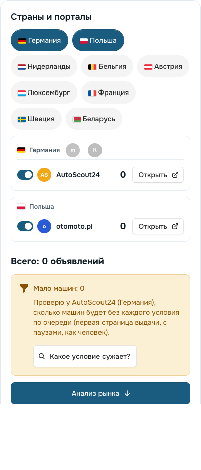 | 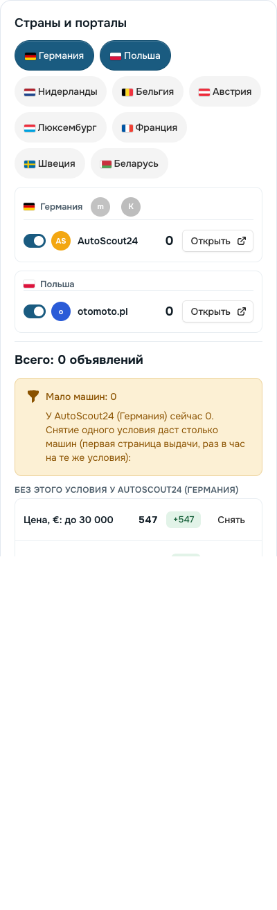 |
| 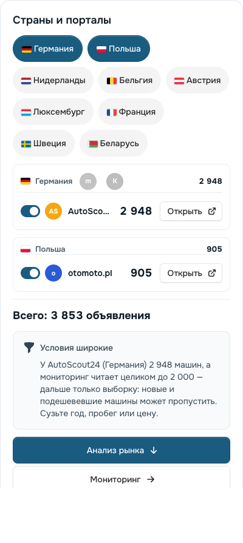 | 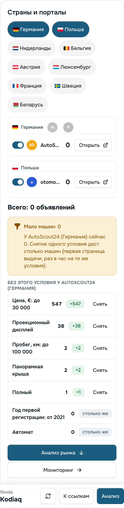 |

Ещё снимки: `design/search-ideas-1105/narrow-375.png`, `wide-375.png`. Числа «широко» на снимке (2 948 / 905) —
показ вида, не замер.

**Код.** `App\Portals\ConditionHint` — решение и план. `Livewire\Dealers\ConditionHint` — плашка. Добавлен
`PortalCounter::requestSets`. Тексты — `lang/*/proto.php` RU / PL / EN. Порог — `ZROK_PROTO_CONDITION_HINT_BELOW`
(20), предел строк — 8. Тест `DealersConditionHintTest` (6). Все тесты платформы: 3 765 прошли, 40 пропущены. Pint —
чисто.

**Не сделано (до выкладки):** подсказка только на форме — на рабочем виде «Анализа» и на «Мониторинге» её нет; два
условия сразу не снимаются; mobile.de не проверяется: его читает расширение, а лишняя вкладка у менеджера ради
подсказки — плохая идея.

## 4. Прототип 2 — «Текст продавцу для торга» (`proto-haggle-1105`, 3а.68.2)

**Зачем.** Машина нравится клиенту, но стоит выше рынка или давно продаётся. Менеджер пишет продавцу на немецком,
нидерландском или шведском — долго, и доводы каждый раз собирает руками. Платформа уже знает доводы: сколько дней
объявление висит и почём похожие машины.

**Как работает.**
- «⋯» машины «Мониторинга» → «Текст продавцу (торг)» открывает окно.
- **Факты в окне:** дни на портале; медиана похожих машин того же рынка по цене объявления (год ±1, пробег ±20 %,
  мощность ±15 %, не меньше шести — то же правило, что «К рынку»); предложение в % от цены.
- **Предложение цены:** −3 % от цены; с 30 дней на портале −5 %, с 60 дней −7 %. Если медиана похожих ниже — до
  медианы, но не дальше −10 %. Округление вниз: 100 €, 500 zł, 1 000 kr.
- **Письмо — на языке портала:** mobile.de, AutoScout24 DE / AT / LU, Kleinanzeigen — немецкий; otomoto — польский;
  Marktplaats, AutoScout24 NL, 2dehands — нидерландский; AutoScout24 BE / FR, ParuVendu — французский; Blocket —
  шведский; есть английский.
- **Что в письме:** только правда. «N дней на портале» — с 30 дней; «похожие дешевле» — только когда это так; вопрос
  о НДС — когда портал о нём не сказал и продавец не частник. Подпись — менеджер, фирма и телефон из «Настроек фирмы».
- Язык и цену менеджер меняет, текст правит в поле. «Скопировать» кладёт тему и текст в буфер.
- **Платформа ничего не отправляет и не записывает.** av.by прототип не берёт.

Пример (выдуманные объявления, Octavia Combi 2021, 27 900 €, 47 дней, медиана 8 похожих — 24 400 €) — платформа
советует 25 100 € (−10 %):

| | |
|---|---|
| 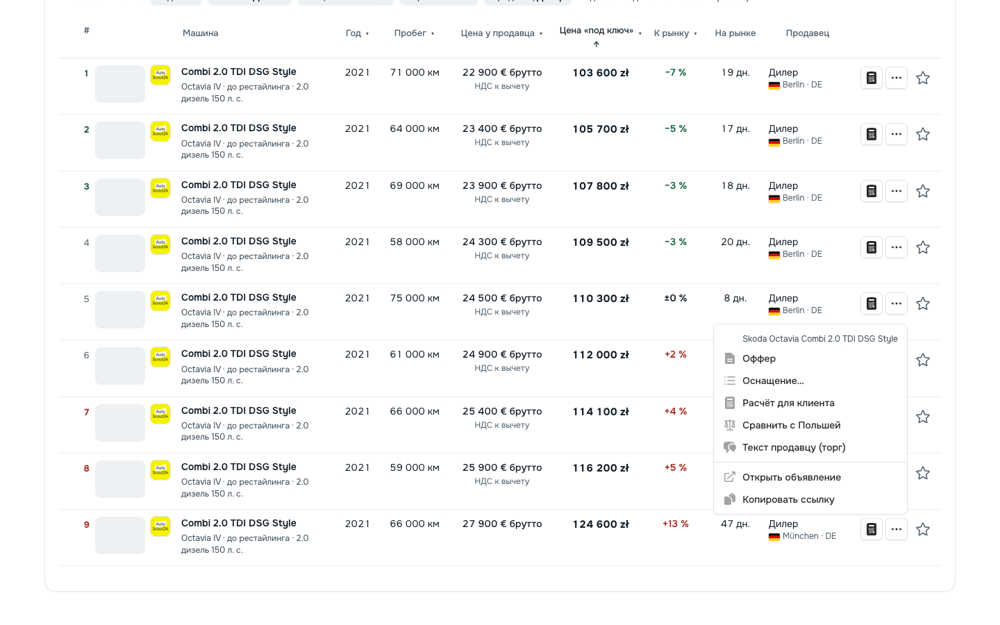 | 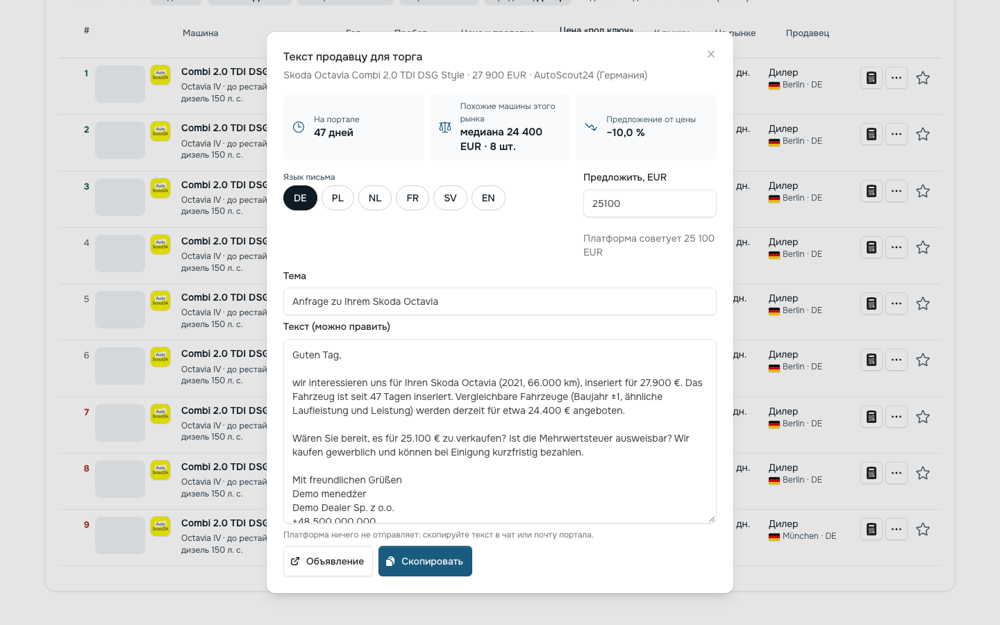 |
| 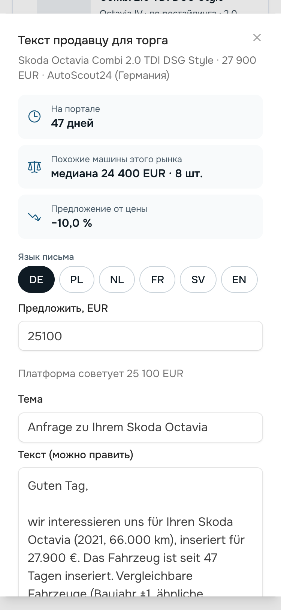 | |

**Код.** `App\Portals\HaggleText` — язык, медиана, цена, письмо. `Livewire\Dealers\HaggleText` — окно. Образцы писем —
`resources/data/prototypes/haggle.php`, тексты окна — `lang/*/haggle.php`. Доли скидки — `config/proto_haggle.php`:
это значения по умолчанию прототипа, при переходе в продукт станут настройкой компании-дилера. Тест
`DealersHaggleTest` (5). Все тесты платформы: 3 782 прошли, 40 пропущены. Pint — чисто.

**Не сделано (до выкладки):**
- тексты DE / NL / FR / SV — проверка носителем;
- доли — в «Настройки фирмы»;
- то же окно в списке «Анализа»;
- отметка «писали продавцу» у машины — нужна запись, значит, решение владельца.

## 5. Прототип 3 — пустая главная «три шага картинкой» (`proto-home-steps-1105`, 3а.68.3)

**Зачем.** Решение владельца 29.10 («новичок: пустая главная — три шага картинкой; без тура»), в «один путь» не вошло.
Платформа продаётся многим дилерам: у каждого нового сотрудника первая встреча с разделом — пустая страница.

**Как работает.** У учётной записи без подборок вместо одной фразы — три карточки «① Условия · ② Анализ ·
③ Мониторинг». В каждой — маленькая картинка из деталей платформы с примерными данными («пример»): отметки
условий и флажки стран; полосы медианы «под ключ» по странам; «Сегодня: +3 новых, 2 подешевели, 1 выгодная». Под
картинкой — одна фраза. Ниже — одна кнопка «Создать первую подборку». Тура и всплывающих подсказок нет.

| | |
|---|---|
| 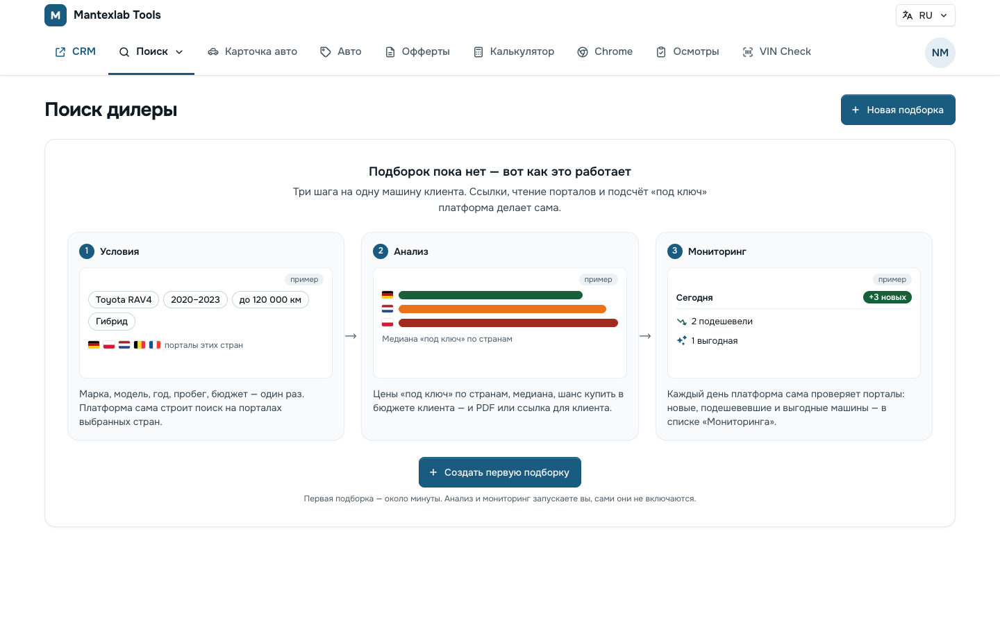 | 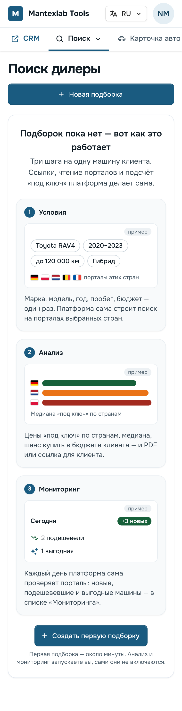 |

Подсказка «Нажмите на подборку, анализ или мониторинг в строке…» над пустой главной скрыта: строк там ещё нет.
Когда подборка появилась — главная обычная, шагов нет.

**Код.** Вид — `resources/views/livewire/dealers/partials/home-steps.blade.php`, подключён в `dealers/index.blade.php`
только при `! $hasAny`. Тексты — `lang/*/home_steps.php` RU / PL / EN, переключатель — `config/proto_home_steps.php`
(`ZROK_PROTO_HOME_STEPS`). Тест `DealersHomeStepsTest` (4): выключено — прежняя фраза; включено — три шага и кнопка;
подборки есть — шагов нет; польский и английский. Все тесты платформы: 3 781 прошли, 40 пропущены. Pint — чисто. Коммит `41d24c78`.

**Не сделано (до выкладки):** картинки — из деталей платформы, не снимки настоящих экранов (снимки устаревали бы при
каждой правке вида); пример условий один для всех дилеров (Toyota RAV4) — при желании его можно брать из настроек
компании.

## 6. Вопросы владельцу (да / нет, по номерам)

1. **Прототип 1 «узко / широко»** — довести до выкладки (плюс рабочий вид «Анализа»)? Порог «мало» — 20 машин —
   подходит?
2. Подсказку «широко» показывать и на «Мониторинге», рядом с запуском?
3. **Прототип 2 «текст продавцу»** — довести до выкладки? Доли −3 / −5 / −7 %, не дальше −10 % — подходят (станут
   настройкой фирмы)?
4. Тексты письма на немецком, нидерландском, французском и шведском — отдать на проверку носителю (кто проверяет)?
5. **Прототип 3 «три шага»** — выкладывать?
6. **willhaben.at** — разрешаете замер с сервера (2–3 запроса с паузами, без входа; делает тот, кому можно `ssh`)?
7. OLX.pl, AutoTrack, Bytbil, luxauto.lu — **не добавляем** — согласны?
8. **«Выгодные сегодня» на главной** (И9) — делать следующим прототипом?
9. **«Нравится» клиента на ссылке** (И10) — делать? Нужна одна миграция — файл будет в ветке, запуск только по «да».
10. **M16 по годам** — сначала посчитать на сервере, сколько мониторингов упираются в предел целого чтения (только
    чтение базы)?
11. Недельный отчёт клиенту (И5) и оповещения (И11) — ждут F6 (Telegram или почта сервера). Ставить F6 первым?

## 7. Как посмотреть прототип (только локально)

- Ветки платформы: `proto-narrow-1105`, `proto-haggle-1105`, `proto-home-steps-1105` — на GitHub, **не слиты,
  не выложены**, у каждой своя основа от `main`. Миграций нет.
- Включить на своей копии: в `platform/.env` — `ZROK_PROTO_CONDITION_HINT=true`, `ZROK_PROTO_HAGGLE=true` или
  `ZROK_PROTO_HOME_STEPS=true`. По умолчанию — выключено; на сервере этих строк нет.
- Слияние: ветки независимы. Строки доски (3а.68.1–3а.68.3) и контракта стоят рядом — при слиянии второй и третьей
  ветки нужно оставить обе строки.

## 8. Решения владельца 07.11 и план волн

Ответ владельца на §6: «да, делаем все и по волнам» (CONFIRMED) — вопросы 1–3 и 5–10 — «да». Без ответа остались
двое: кто проверяет тексты письма на языках продавцов (вопрос 4) и кто ставит F6 (вопрос 11). Для F6 нужен ключ
Telegram-бота в «Настройки → Компания» или почта сервера — это делает владелец или администратор.
Ответ владельца 07.11, после волны 1: «La Centrale тогда пока оставим, все буду делать я по этому проекту» (CONFIRMED) —
волна 8 отложена; тексты продавцу на языках (вопрос 4) проверяет сам владелец, F6 (вопрос 11) ставит сам владелец.
Добавлено владельцем: «узко и широко проверь со всех сторон, чтобы программа научилась крутить всеми параметрами в
разных комбинациях, но отходила по умолчанию не слишком далеко от заданных параметров без согласия менеджера, чтобы не
генерить лишней работы и нагрузки» и последней волной — lacentrale.fr через расширение.

| Волна | Что | Ветка платформы | Доска |
|---|---|---|---|
| 1 | «Узко / широко» в продукт: «Анализ» (форма и рабочий вид) и «Мониторинг» — **выложено 07.11** | `search-narrow-wide` | 3а.69.2 (3а.69 занят av.by) |
| 2 | «Текст продавцу для торга» в продукт; доли скидок — настройка фирмы — готово, **не выкладывать** («пока оставь», 07.11) | `search-haggle` | 3а.70 |
| 3 | Пустая главная «три шага» в продукт — **выложено 08.11** | `search-home-steps` | 3а.71 |
| 4 | «Выгодные сегодня» на главной (И9) | — | — |
| 5 | «Нравится» клиента на ссылке (И10), одна миграция — запуск по «да» | — | — |
| 6 | willhaben.at: замер с сервера, затем сборщик | — | — |
| 7 | M16: подсчёт на сервере, сколько мониторингов упираются в предел целого чтения (только чтение базы) | — | — |
| 8 | lacentrale.fr через расширение — **отложено** (владелец 07.11: «La Centrale тогда пока оставим») | — | — |

**Правило волны 1 «не уходить далеко» (CONFIRMED, владелец 07.11):**
- **Ближние шаги** платформа считает сама, по нажатию «Подобрать условия». Это запас «Около фильтров» (3б.27):
  цена, пробег и мощность — на 10 %, год — на один и только в том же поколении, без одной опции.
- **Дальние шаги** — только после второго нажатия «Искать дальше». Кнопка заранее говорит, сколько запросов к порталу
  уйдёт. Запас 20 %, год ±2. У «узко» — ещё без коробки, привода, топлива, кузова, цвета, версии и истории машины.
- Марку и модель подбор не трогает никогда. Продавца и «на ходу» — тоже, пока они стоят по умолчанию фирмы.
- **Сочетания** считаются ступенями, чтобы не делать лишних запросов:
  1. Сначала все шаги сразу. Если машин не прибавилось или их всё равно мало (у «широко» — всё равно много), по одному
     и парами не считается: больше, чем все сразу, они не дадут. Дальше — только «Искать дальше».
  2. Потом каждый шаг по одному, не больше 8 на нажатие. Хватило одного — конец.
  3. Пары — только из трёх лучших шагов и только если ни одного шага по одному не хватает, а всем сразу — хватает.
  Считается только первая страница выдачи одного портала, который сервер читает сам, с паузой живого покупателя. Число
  живёт час и общее у всех подборок. mobile.de и av.by подбор не спрашивает.
- **«Широко»** только сужает границы, которые уже есть (год, пробег, цена, мощность), в пределах того же запаса. Новых
  условий подбор не добавляет.

**lacentrale.fr — что отличается от mobile.de (проверено 07.11 с Мака, одна попытка, капчу не решали):**
- **Сервер не прочитает.** Каждая страница стоит за DataDome: запрос без браузера — 403, во встроенном браузере с
  первого открытия — капча DataDome. Обходить защиту нельзя (правило платформы), поэтому возможно только расширение в
  Chrome менеджера.
- **Капча и в браузере менеджера.** DataDome может показать её и живому человеку, особенно если читать много страниц
  подряд. Капчу решает только сам менеджер. Фоновая вкладка расширения, как у mobile.de, на капче молча встанет, поэтому
  расширение должно узнавать страницу `captcha-delivery.com` и звать менеджера.
- **Риск для адреса офиса.** DataDome ставит оценку адресу. Частое чтение может закрыть La Centrale с этого адреса и
  для обычной работы. Темп нужен реже, чем у mobile.de, и с пределом страниц в день.
- **Правила сайта.** `robots.txt` закрывает выдачу (`/listing*`) для всех роботов и отдельно — для сборщика-агрегатора
  LeParking. Условия сайта, скорее всего, тоже против автоматического чтения. Нужно решение владельца (OPEN).
- **Данные — французские.** Цена — TTC, с НДС. Нетто — только при «TVA récupérable». Мощность бывает двух видов:
  «ch DIN», настоящая, и «CV fiscaux» — налоговые лошади, 7–11 «CV» у машины на 150 л. с. Если их перепутать, выйдет
  ошибка мощности и акциза. Ещё есть Crit'Air, история HistoVec и своя оценка цены «cote La Centrale».
- **Устройство страницы неизвестно.** Образец выдачи и объявления нужен из Chrome владельца, сохранённой страницей.
  Это ручное открытие, как у человека.
- Расширению нужно новое разрешение на сайт и новая версия: каждый менеджер обновит его сам. Сколько машин повторяют
  AutoScout24 FR и ParuVendu — неизвестно, это покажет первый замер.

## 9. Волна 1 «узко / широко» — выложено 07.11

Ветка платформы `search-narrow-wide` (`3ecd9fa3`, `ff78e90b`, со свежим `main` — `32462ef7`, на GitHub), доска 3а.69.2 (номер 3а.69 занял выложенный av.by другого чата),
без миграций. **Выложено 07.11** по «выкладывай» владельца: сервер на `985fe8cb`, стили не менялись, `/up` и сайт — 200,
Horizon работает, ошибок нет; на сервере «Mało aut» с кнопкой «Dobierz warunki» видно у подборок 21 и 46.
Волна 2 «Текст продавцу» — по слову владельца «текст продавцу пока оставь» не выкладывается.
Прототип 3а.68.1 убран, отдельно не выкладывается.

- **Где видно.** В форме «Szukaj u dealerów» (полный поиск и рабочий вид «Анализа») — под «Всего» у «Стран и
  порталов». На «Мониторинге» — над «Запустить мониторинг», по числам последней проверки и с ценой мониторинга.
- **Как работает.** Блок появляется сам, но портал не спрашивает, пока менеджер не нажмёт «Подобрать условия»
  (у «узко») или «Как сузить, не уходя далеко?» (у «широко»).
  - Строки: «всё в пределах запаса сразу», дальше каждый шаг по одному. У каждой — число машин, «+N» / «−N», «хватит» и
    «Применить».
  - В форме «Применить» меняет поля, записывает обычное «Подтвердить». На «Мониторинге» — сразу запись и проверка.
- **Правило ступеней** — §8. Лишнее не считается: если всё сразу нужного не дало, по одному и парами портал больше не
  спрашивается.
- **«Искать дальше»** заранее говорит, сколько запросов самое большее уйдёт. Обычно уходит меньше.
- **Живой замер 07.11** (AutoScout24 DE, сервер читает сам, первая страница, пауза живого покупателя):

  | Подборка | Было | Что нашёл подбор | Запросов, время |
  |---|---|---|---|
  | Kodiaq 2021+, до 100 000 км, до 30 000 €, автомат, полный, панорама и HUD | 0 машин | всё в пределах запаса — 512; без HUD — 38 («хватит»); без панорамы — 2; цена до 33 000, пробег до 110 000, год от 2020 — по 0 | 7 наборов, 54 с; пары не понадобились |
  | Golf 2017–2022, до 150 000 км | 5 362 (мониторинг читает целиком до 2 000) | всё в пределах запаса — 2 744, в пределах запаса до 2 000 не сузить; «Искать дальше» — до 7 запросов | 2 набора (до правила «нужного не дало — конец» было 5) |

- **Проверено.** 36 тестов подбора: запас со всех сторон, поколение года, «никогда не трогает» (марка, модель, страны,
  значения по умолчанию фирмы), ступени, согласие на дальнее, отказ портала, общий час на всех, цена мониторинга, закрытые
  поля экрана, RU / PL / EN. Полный прогон платформы со свежим `main` — 3 863 теста, все прошли (40 пропущены, как
  раньше). Экраны 1440 и 375 — `docs/design/search-ideas-1105/wave1-*`.
- **Ждёт владельца:** «выкладывай» волны 1. Вопросы 4 и 11 — владелец делает сам (§8).

## 10. Волна 2 «Текст продавцу» — сделано 07.11 (не выложено)

Ветка платформы `search-haggle` (`e4b7522a`, `daf3ea85`, со свежим `main`, на GitHub), доска 3а.70, без миграций. Прототип 3а.68.2
слит в неё и убран, отдельно не выкладывается.

- **Где видно.** У машины «Анализа» (меню «⋯» строки списка) и «Мониторинга» («⋯» в «Списке авто») — «Текст продавцу».
  Окно: дни на портале, медиана похожих машин того же рынка (по цене объявления, в его валюте), «предложение от цены»,
  язык письма (по порталу, можно переключить), поле цены, тема и текст. «Скопировать» кладёт письмо в буфер,
  «Объявление» открывает его. Платформа ничего не отправляет и не записывает. av.by — без письма.
- **Доли скидки — настройка компании.** «Настройки → Компания» → «Торг с продавцом» (только администратор): сразу −3 %,
  объявлению с 30 дней −5 %, с 60 дней −7 %, похожие дешевле — до их медианы, но не больше −10 %; о днях письмо говорит
  с 30 дней. Доли проверяются по возрастанию и не больше 50 %. Каждый дилер ставит свои.
- **Тексты** — на проверке у владельца: [HAGGLE-TEXTS-2026-11.md](HAGGLE-TEXTS-2026-11.md) (все шесть языков с переводом,
  пример целиком, пять вопросов). При переносе поправлены три строки (§4 там).
- **Включено по умолчанию**, выключатель `ZROK_HAGGLE=false` в `.env` сервера.
- **Проверено.** 7 тестов «Текста продавцу» (оба окна, доли из настроек и их проверка, выключатель, чужое окно и чужая
  подборка, чужой сотрудник, НДС), настройки компании и кнопки оффера — 19 тестов. Полный прогон со свежим `main` —
  3 864 теста: прошли все, кроме двух тестов VIN, которые при параллельном прогоне делят папку робота; отдельно оба
  прошли (к волне не относятся). Экраны — `docs/design/search-ideas-1105/wave2-*`.
- **Не сделано (нужна миграция):** отметка «писали продавцу» у машины. Сейчас окно ничего не запоминает.
- **Ждёт владельца:** «выкладывай» волн 1 и 2 (можно вместе) и ответы по текстам.

## 11. Волна 3 «Три шага» — выложено 08.11

Ветка платформы `search-home-steps` (`82e6b4e6`, со свежим `main`, на GitHub), доска 3а.71, без миграций. Прототип
3а.68.3 слит в неё, его переключатель `config/proto_home_steps.php` убран.

- **Что видит менеджер.** У учётной записи без своих подборок главная «Поиска дилеры» — «Подборок пока нет — вот как это
  работает» и три карточки «① Условия · ② Анализ · ③ Мониторинг» с примерами (подписано «пример», из базы ничего не
  берётся), ниже одна кнопка «Создать первую подборку». Тура и всплывающих подсказок нет (решение 29.10). Когда первая
  подборка появилась — главная обычная.
- **Поправлено при переносе.** Фраза «Мониторинга» — «Включённый мониторинг каждый день сам проверяет порталы…»: раньше
  читалось так, будто мониторинг включается сам (рядом стоит «сами они не включаются»). RU / PL / EN.
- **Включено по умолчанию**, выключатель `ZROK_HOME_STEPS=false` в `.env` сервера (прежняя фраза и кнопка).
- **Проверено.** 4 теста `DealersHomeStepsTest` (выключатель, три шага, подборки есть — шагов нет, PL и EN). Полный
  прогон — 3 929 тестов: прошли все, кроме двух, которые при параллельном прогоне падают от нагрузки (VIN — общая папка
  робота, «Прочитать mobile.de» — ожидание опроса); отдельно оба прошли. Pint — чисто по файлам волны. Снимки на
  локальной копии — RU / PL / EN, 1440 и 375 px, без прокрутки вбок.
- **На выкладке:** стили меняются (новые классы) — собрать с Flux Pro сервера и залить `public/build`.

| | |
|---|---|
| 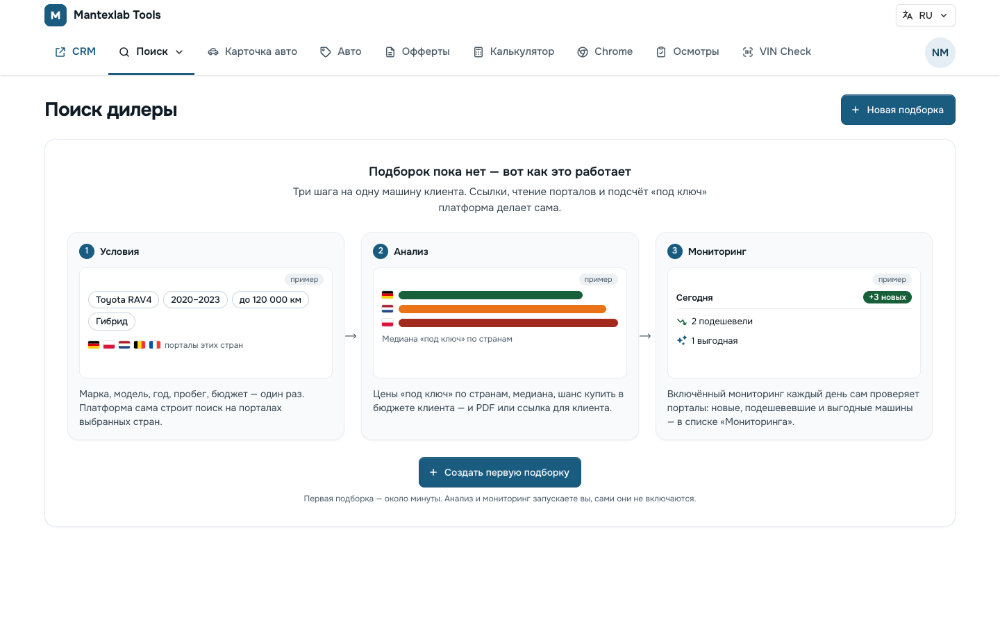 | 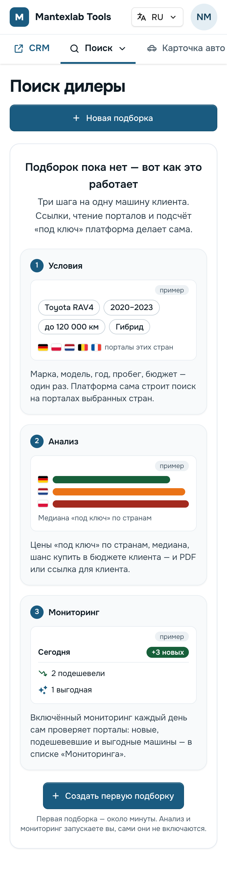 |

**Выкладка 08.11** по «Выкладывай волну 3» владельца: сервер на `bd85191b` (вместе ушли только доска и расширение 0.4.1 —
папку расширения сервер не исполняет), миграций нет; стили собраны с Flux Pro сервера (у сервера ничего не пропало,
добавлено 4 класса) и залиты до `git pull`; `/up` и сайт — 200, Horizon работает, ошибок нет, `zrok.home_steps.enabled`
— `true`. Сейчас у всех трёх учётных записей сервера подборки есть — три шага увидит первый новый сотрудник.
